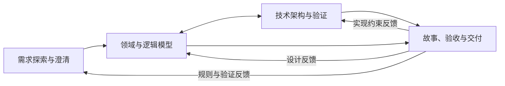

# 项目需求与设计 Skill

将项目想法、已有实现或变更转为可独立理解的需求、模型、技术方案和研发测试交付安排。适用于业务系统、工具、SDK、数据处理及跨系统项目，按实际问题选择分析深度，不绑定特定元模型或技术栈。

技能入口为 [SKILL.md](SKILL.md)。源码维护目录、实际安装目录与被分析项目的材料目录分别管理，业务资料不写入技能包。

## 分析路径与能力



先有全局概要，再逐步深入近期切片。模型与架构可以往返，关键技术风险可提前验证；每阶段及子能力也可独立进入，不要求全项目设计完成后才拆故事。

| 主能力 | 结果与边界 |
|---|---|
| [需求探索与澄清](references/stages/discovery.md) | 目标、场景、能力、规则、范围与成功标准形成整体；按需做 [价值与可行性](references/stages/feasibility.md)、[概要与范围](references/stages/outline.md) |
| [领域与数据模型](references/stages/modeling.md) | 概念语义、关系、规则承载与必要演进方案，配总览图和场景带读；物理设计结合技术选择完善 |
| [技术架构与验证](references/stages/architecture.md) | 明确分层、组件、技术、接口与数据协作、设施和部署，配结构／运行／部署视图；局部比较或 demo 按请求范围交付 |
| [需求细化与交付推进](references/stages/delivery.md) | 先决议本期需要建立故事的需求边界，再逐项拆分、细化故事、AC 与任务；完整交接逐故事达到研发测试可执行深度 |
| [变更分析](references/changes/impact.md) | 比较有效基线与新结论，定位影响，修订相关主题及下游引用 |

建模方法和技术方案分别选择，已定选择直接用于模型或架构设计。按需使用 [建模选择](references/selection/modeling.md) 和 [技术选型](references/selection/technology.md)，不在每次需求讨论中重选方法。纯代码修复、部署操作和技能维护不启动业务分析流程。

仅请求故事与 AC 时按细化标准结束；完整研发测试交接另判断必要设计与任务是否充分。本地每故事独立文档，任务系统为正式来源时在系统维护完整故事与关联任务，总览保留边界、批次及依赖。已有需求边界、稳定 ID 和实际任务直接复用，不预先固定故事数量，也不因新一轮讨论重建。

## 使用

技能已被宿主发现时，在目标项目中使用：

```text
$project-design 帮我分析当前项目。本轮先澄清目标和首期范围，已有资料位于……
```

可直接限定任务，例如“只评估这个方案的可行性”“设计这个组件”“沿用已选技术，检查当前需求的承载缺口”或“仅细化退款撤销故事及验收条件”。完成指定范围即可结束；已有连续推进授权时继续可推进部分。

尚未被发现时，可明确要求读取实际入口，例如：

```text
请读取当前项目的 .agents/skills/project-design/SKILL.md，仅梳理这些资料涉及的目标、场景与范围。
```

源码中存在入口、文件校验通过、宿主发现、显式调用成功和自然语言自动选择是不同状态。手动读取只能说明执行流程，不证明自动触发生效。

## 文档怎样组织

[共用文档规范](references/shared/document-structure.md) 统一约束主文、专题与必要子专题：先确定各篇问题与分工，再从整体展开局部；同义主题归并，混合责任拆开，每项定义只在一个权威章节维护。主文保留概貌，其他篇用必要摘要、本方责任或验收表达关联精确引用；可独立理解以正文及必要引用为单位，不要求复制整套定义。正文直接陈述需求或机制，来源及确认经过单独记录。

当前正文与工作材料分区。未配置本地位置时：

| 位置 | 内容 |
|---|---|
| `docs/project-analysis/` | 项目概览、四阶段主文、需求／设计专题、本地独立故事及共享场景 |
| `docs/project-analysis-support/` | 分区保存决策、来源、交接、变更、验证、附件、未整合草稿及必要归档 |
| 项目 `experiments/` 或既有实验位置 | 可运行 demo、环境与原始证据，原位引用，不重复复制 |

正式维护的草拟规范可原位迭代，目录分区不代表已批准或发布。已整合且无保留价值的中间文件在维护范围内清理；保留必要证据与有效引用。系统运行机制属于设计，代理的工具执行、委托与写作过程属于辅助记录。

交付前由独立上下文的子 Agent 阅读评审：不继承主会话和编写经过，只基于当前正文及必要规范引用判断能否独立理解。主 Agent 处理意见并按需复评，评审记录保存在辅助验证区；自检不替代独立评审，工具不可用时如实标记未完成。具体见 [阅读评审规则](references/shared/document-structure.md#交付前的阅读检查)。

持续分析通过项目根目录 `项目上下文.md`，或已授权远端页面的配置，定位正式／辅助区域、任务系统与更新约定。首次按 [模板](assets/项目上下文模板.md) 从已知信息建立，已有等价配置优先复用。配置不保存进展、业务正文或凭据；纯远端项目不要求建本地仓库，临时咨询不强制建档。详见 [项目配置](references/shared/project-context.md)。

## 安装与更新

仓库：[FarmerLi/project-design-skill](https://github.com/FarmerLi/project-design-skill)。技能名称和安装目录名均为 `project-design`。将下面提示词交给 Agent：

```text
请读取 https://github.com/FarmerLi/project-design-skill 仓库中的《安装与更新.md》，将 project-design 安装到当前项目；已有安装则更新到最新正式版。请按指引直接完成版本检查、必要的整包下载、备份替换和安装校验，并报告版本与安装位置。
```

默认安装到目标项目 `.agents/skills/project-design/`，引入时无需修改项目 `AGENTS.md`；个人全局、固定 Tag 或开发分支按实际请求选择。完整流程见 [安装与更新](安装与更新.md)，不在本文重复安装规则。

旧阶段文件和编号按内容及有效版本复用，升级不自动迁移所有项目。恢复时从项目配置定位概览、独立交接及相关有效材料，核对版本后继续；过期交接不能覆盖更新后的定义。方法见 [现状与恢复](references/entry/context.md)。

## 技能包的维护分工

| 位置 | 职责 |
|---|---|
| [SKILL.md](SKILL.md) | 用途、入口、共同约束及按需路由 |
| `references/stages/` | 四阶段与内部子方法，规定该能力的分析深度和完成条件 |
| `references/shared/` | 文档结构、项目配置、状态版本、规格、追溯和就绪检查，各维护一份规则 |
| `references/selection/` | 方法／技术选择；[制品准入细则](references/selection/technology-admission.md) 独立承接按使用范围的核验 |
| `references/entry/`、`references/changes/`、`references/integrations/` | 现状恢复、影响处理、任务与文档落地 |
| `references/examples/`、`assets/` | 可选示例和输出模板，不构成项目事实或额外门禁 |
| `tests/` | 行为判据；`fixtures/` 保存输入，`records/` 保存实际验证记录，不作运行依赖 |
| `maintenance/archive/` | 已完成修改预案及历史文件快照，不作为当前规则或安装清单 |

公共规则在对应 reference 维护，阶段方法只写本能力差异及必要引用；不要将后续修复逐条叠加到入口或复制到所有文件。大型专题是否拆分取决于阅读及维护责任，不按统一字数或层数规定。

维护时校验技能格式、元数据、Markdown 文件引用与锚点，再按 [行为验证](tests/行为验证.md) 核对受影响场景和相邻反例。格式、规则推演、隔离执行、图语法与视觉检查分别报告，未执行的行为测试不能称为通过。历史记录不证明新规则已验证，[历史哈希快照](maintenance/archive/历史文件哈希快照.json) 也不代表当前文件清单。

方法参考包括 [AI 需求探索与确认提示词 V9.0](https://github.com/sharptoolbox/ontology-driven-dev/blob/main/references/AI需求探索与确认提示词V9.0.md)；其先草拟再澄清、区分依据与建议的方法已转为本包自包含规则，上游不作为运行依赖。

本项目采用 [Apache License 2.0](LICENSE)。
