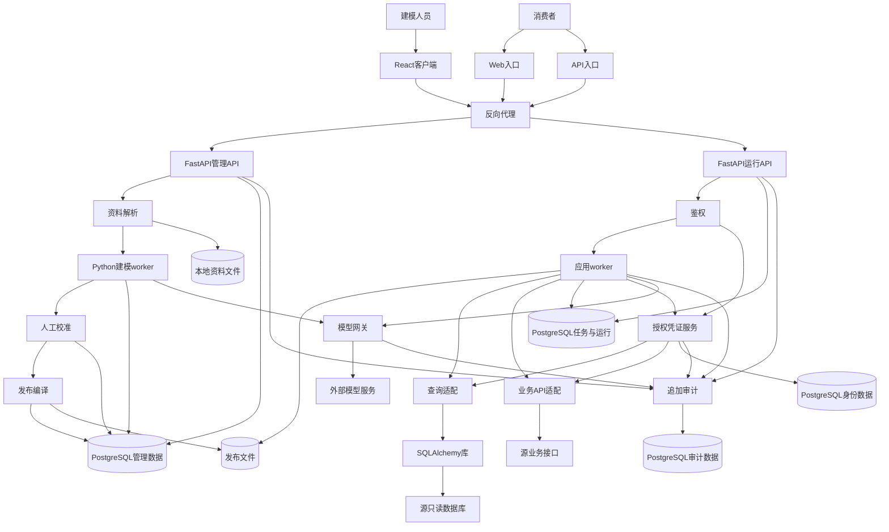

# 设计与交付整理输入夹具

以下是模拟材料，用于 [模型、架构、交互与 UI 设计、交付整理用例](../behavior-validation.md#模型架构交互与-ui-设计交付整理)，不是实际产品需求或执行证据。将“案例目录”替换为隔离目录，只提供当前请求、所需原始材料及固定技能入口；不提供未来轮次或观察标准。模型、架构、交互与 UI 设计、交付各组使用独立上下文，多轮结束分别保留产物快照。

## 共用原始材料

产品是跨行业接口接入工具。接入人员修订能力定义并发布；应用只能通过已发布定义调用能力，不得绕过定义服务直连源接口。只有获相应授权的应用可调用，拒绝时不得触发源调用。初始规则是每项调用固定引用一个已发布修订，不自动切换。JSON 和 Markdown 都在产品目标范围，具体实现批次未定。没有存储选型、容量目标和真实业务连接。

教学接口仅用于映射举例，本轮尚未纳入正式集成：`GET /courses/{courseId}/hours`，契约标识 `teaching-sample-1`。输入为字符串课程号，响应的 `teachingHours` 为整数；说明明确单位是分钟。测试数据为课程 `C-17`、响应 90 分钟、教务测试账号，测试账号本身不代表平台权限政策。没有执行过真实业务调用。

## 模型组

第一轮请求：

> 根据共用材料设计本轮概念与逻辑模型，说明规则如何表达。只做第二阶段设计，在案例目录持续维护，不选择技术、不实现应用；未知标明即可。

第二轮请求：

> 参数说明还要能定位到原始材料，这与之前的能力定义维护是同一件事。把“源绑定”统一改称“外部绑定”，含义不变；若初稿采用了其他等义名称，沿用初稿名称也可以。继续更新已有模型。

第三轮请求：

> 现在确定，教学系统进入本轮正式集成范围，采用上述契约作为对接依据；仍需记录它尚无真实连接。请更新相关设计，不实现应用。

第四轮前，由执行者在案例内保存旧模型的真实快照或哈希，并预置一份引用该模型的设计草案：“每项调用固定使用一个已发布修订，调用方不自动切换。”不得预写已实现或验证通过。

第四轮请求：

> 修订选用规则现已改变：同一调用方后续请求跟随最新已发布修订，开始执行的请求在结束前保持其开始时选定的修订。请更新模型及影响说明；预置的旧设计暂不重写，不实现应用。

局部反例请求，使用新的隔离上下文：

> 只整理一个无状态日期解析函数的类型与错误契约。输入为不含时区的 ISO 日期文本 YYYY-MM-DD，输出为日期值；非法日期、空串和非字符串返回不同错误码，不改变旧接口。没有持久化或外部调用。不需要架构或迁移设计。

## 架构组

第一轮请求：

> 根据共用材料设计本轮架构，不选具体库、不实现应用。附有一份已有实验记录：离线脚本将硬编码的教学参数发给替身，返回预置的 90 分钟，单条通过；没有经过定义服务和授权检查。请结合记录说明当前方案、取舍、证据和限制，在案例目录维护。

第二轮请求：

> 增加一份同类脚本记录：10 个固定课程号均返回预置值，其他路径和环境未变。只更新分析，不实现或重新执行。

第三轮请求：

> 新增已确认的外部约束：源系统按调用应用分配独立身份，不能共享一个服务账号；仍不得绕过定义服务。请更新当前候选架构和影响，不实现应用，实际身份凭据和真实执行尚未具备。

局部反例请求，使用新的隔离上下文，只附第一轮实验记录：

> 仅核对这份局部 demo 记录支持什么结论、还缺什么证据，不做架构设计、不实现或运行。

## 交互与 UI 设计组

I-01 使用共用材料、系统实现方案组的完整系统设计输入，以及以下已确认的交互事实：

> 消费者可以查看一次调用的进行状态和结果。缺少任一必需来源授权时显示待授权；授权完成后可继续原调用。拒绝时显示拒绝结果，不得触发源系统调用。外部动作发出后超时可能已经生效，界面不得把重试描述为必然不重复。消费者没有编辑能力定义、查看其他空间调用或公开分享结果的权限。页面使用现有 Web 应用导航；本轮没有视觉规范，也没有真实用户测试。

I-01 没有原型或原型工具配置；设计成果保存到案例目录。

I-01 请求：

> 根据上述已确认需求和设计，完成消费者“发起能力调用并查看结果”的交互与 UI 设计。以设计说明及必要流程／状态图明确核心流程，形成交互和 UI 规范并核对场景。不实现业务应用、不调用真实服务，也不自行确定重试政策。保存设计产物到案例目录，并说明仍缺什么。

I-02 使用现有列表页、已定后端接口及有效交互与 UI 规范，不要求复用共用材料：

> 这个列表页已经有侧栏、搜索、分页和条目标题操作。删除规则与接口已经确定：仅有权用户可删除，成功后条目消失，失败时保留条目。现在只改善删除确认、执行中、成功和失败恢复的交互，完善当前操作的设计说明，不改信息架构、业务权限或接口。给出可直接交给研发和测试的交互与 UI 设计说明和规范，不实现应用。

I-04 使用独立上下文，材料与请求：

> 请评审这份第 4 阶段交接草稿，只依据以下材料指出能否交接及还需要什么，不修改文件。内部知识工具本期包含搜索、查看、收藏和取消收藏；已有有效交互与 UI 规范、整体页面关系和详细设计，没有原型。详细设计仍允许从收藏列表打开无权限条目，作者已将此问题转交需求和模型阶段，但没有修订；本期范围没有缩小。作者只阅读预先画好的“初始→等待→成功／失败”状态图，就将运行验证记为通过，没有实际执行证据。交接草稿声称“核心流程验证通过，问题已经回退，阶段完成”。业务已明确无权限条目不可查看，不讨论新增权限政策。

I-07 使用独立上下文，材料与请求：

> 我们正在设计内部知识工具，已确定员工可以搜索和查看有权限的条目、收藏条目、查看自己的收藏及取消收藏。无权限条目不能查看，也不出现在收藏列表；收藏与取消失败时保留操作前状态，允许用户手动重试。前三阶段已有可用设计，本轮沿用，不讨论分享、分组或审批。现在没有原型和设计系统。请安排第 4 阶段的设计推进方案，说明各步做什么、产出什么以及什么时候可以进入下一步。只在对话回答，不制作原型、不写故事、不建立文件，也不宣称做过用户测试。

I-08 使用独立上下文，材料与请求：

> 项目已有有效设计说明、任务流程、交互规范和设计系统。本轮只讨论保存失败提示的呈现：已定业务与交互是保留输入、显示错误原因、允许用户手动重试；错误区目前颜色与正文相近，键盘用户不易发现。请说明本轮设计应怎样推进、改哪些内容以及怎样验证，不实际修改文件，不改流程、保存政策或品牌规范。

I-09 使用独立上下文，材料与请求：

> 评审详细设计时发现，“新建条目”页面提交失败后保留输入，“编辑条目”失败后却清空输入，“编辑个人资料”失败后只提示错误且不能重试。已确认业务规则是这三类提交失败均保留输入、展示错误原因，并允许用户手动重试，不自动重发。总体设计、公共规范和页面说明目前都有相关描述。请给出设计修订方案，说明各处应该维护什么、怎样检查完成；只在对话回答，不改文件、不决定新的业务政策，不拆故事或研发任务。以上是专家走查发现，没有真实用户测试或产品实现证据。

I-10 使用独立上下文，材料与请求：

> 我们做一个桌面浏览器使用的内部知识工具。本期已确定员工可以搜索和查看有权限的条目、收藏条目、查看自己的收藏及取消收藏；不做移动端、分享、分组或审批。无权限条目不能查看，也不出现在收藏列表；收藏与取消失败时保留操作前状态，展示错误原因并允许手动重试，不自动重发。前三阶段已有可用设计，本轮沿用。没有原型、品牌规范或设计系统，设计建议可以先给草案。现在开始第 4 阶段，请给首轮讨论成果和下一步安排，只在对话中讨论，不制作原型、不建文件、不写故事。

I-11 使用独立上下文，材料与请求：

> 内部知识工具本期包含搜索、查看条目、收藏、查看自己的收藏和取消收藏。已有适用的交互规范和 UI 规范，可直接引用：从列表进入详情后返回应保留来源查询条件，收藏与取消失败保留原状态、显示错误原因并允许手动重试；桌面采用统一 12 列栅格、4px 间距档位、正文 14px／20px 行高、主操作使用 PrimaryButton，失败提示使用 ErrorNotice 的错误图标和文字组合。现有详细设计只覆盖了“搜索→详情→收藏”，但尚未定义收藏列表的入口、它与搜索结果及详情的关系，也没有本期整体页面与任务结构。现在能否据此开始批量细化其他页面？请说明下一步怎么做，只讨论，不改文件。

I-12 使用独立上下文，材料与请求：

> 请评审以下详细设计并给出修订方案，只在对话回答，不修改文件。已确定公共交互规则 INT-01：新建、编辑、个人资料三类表单提交失败都保留输入，显示原因，允许用户手动重试，不自动重发。已确定 UI-01：普通表单字段垂直间距引用 space-form=16px；错误提示使用 ErrorNotice 的图标加文字，不只靠颜色。当前新建页遵循上述规则；编辑页失败后清空输入，字段间距自行改成 12px；个人资料页失败后只把边框变红且没有错误文字。团队另提出将普通表单统一改为 12px，但这仍是待讨论建议，没有替代 UI-01，也没有提出页面特例的依据。请判断能否交接，以及规范、各页面和验证项分别应该怎样处理。没有实际运行或用户测试记录。

## 交付组

第一轮请求：

> 根据共用材料细化“应用通过发布能力进行读取”的故事与验收，并给出本地研发测试任务草稿及依赖。只围绕这个结果，不实现或创建远端任务；相关设计尚未完成，不能编造实现。用教学数据示例说明用例，在案例目录持续维护。

第二轮请求：

> 再强调一次，拒绝未授权请求后不能调用源系统。教学样例只测试 C-17，不限制产品只能查询课程；请继续整理已有故事和计划。

第三轮前，由执行者预置一份模拟旧证据，引用第一轮 AC 的实际快照：本地任务标记为关闭；旧规则替身用例只检查了未授权请求收到拒绝响应，结果通过，未观察源调用。该记录是测试夹具，不是真实产品执行。

第三轮请求：

> 现在新增并确定：应用授权撤销后尚未开始源调用的请求也必须拒绝，已经开始的请求允许结束。请更新故事、AC、相关任务与依赖；保留已有执行记录，不重跑测试、不实现应用。

第四轮请求：

> 进展更新：授权拦截研发任务负责人报告实现完成，但尚未提供实现版本或运行记录；测试数据已经准备，测试尚未执行。只更新计划状态，不改变上述规则。

领域反例请求，使用新的隔离上下文：

> 产品就是教学管理系统。教务管理员只能查询自己负责课程的分钟数，非负责课程拒绝且不返回数据。只给这个功能的故事与 AC，课程及教学角色属于正式范围；不做架构、任务或开发。

## 独立阅读

在新的上下文仅提供相应组的当前正文和必要规范引用，排除聊天、历史、样例分析与执行报告。分别请求：

- 说明模型对象、关键概念／关系、规则承载、适用范围与缺口。
- 说明架构为何这样选择、主要责任和链路、成立条件与未知；若为完整系统方案，还请说明系统分层、模块所用技术、基础设施、运行协作和部署如何解决需求，哪些缺口仍阻塞实施。
- 说明本批用户结果、故事边界、验收判据、依赖以及当前状态；只陈述正文给出的证据摘要，不推测实际执行。

共同补充：无法从提供内容判断的地方请指出，不读取其他材料，不替文档补做设计。完整第五阶段的独立交接另只提供一个执行 Issue／等价任务及其必要引用，请读者说明本次目标、要完成的任务及产出、验证条件及预期、依赖与阻塞，不提供交付总览或原始请求来补全缺口。

## 系统实现方案组

以下请求分别用于 A-04～08，各例使用独立目录和干净上下文。A-05 复制 A-04 的真实产物作为起点并保存输入快照；A-08 使用下方固定材料。原始输入不包含测试判据。

### 完整系统设计输入

产品是跨行业能力发布与调用平台。接入人员上传 JSON／Markdown 资料，或人工维护能力定义、参数和外部接口映射，校准后发布固定版本。消费者只能调用获授权的已发布能力；不得绕过发布定义直接请求外部接口，空间之间的数据和凭证隔离。

Web 和后端 API 使用同一应用定义及权限规则。应用支持多步骤调用，耗时步骤可异步完成；消费者可以查看状态和结果。执行前须具备所有必需来源授权，拒绝时不触发源调用。进程重启后保留发布版本、运行状态和调用事实；外部业务动作发出后超时可能已经生效，不得一律自动重发。

首期部署到一台内部主机，团队主要使用 TypeScript 前端和 Python 后端，可以维护关系数据库和本地文件卷，未选具体框架及新增基础设施，没有既有应用代码。当前没有并发／容量目标和真实源凭据，不得虚构测量值或业务调用已成功。HTTP 来源接口的真实幂等、身份及权限契约仍需逐来源核实。

A-04 请求：

> 使用上述材料完成第三阶段，给出我们据以实现系统的技术方案。未确定的技术可以按这些约束选型并说明依据，在案例目录保存。只做方案与必要查证，不安装依赖、不实现或部署应用，不发起真实业务请求。

A-05 请求，附 A-04 产物：

> 沿用这份方案中已选的技术。现在确定：用户可以在应用启动时再完成多个来源的授权，缺任一必需授权时显示待授权，授权完成后可继续；进程重启也能找回等待的运行。请更新相关方案，不实现应用或调用真实认证服务。

### 阶段完成评审输入

待评草案正文为：

> 系统分表现层、业务层、数据层。表现层接收请求，业务层完成业务，数据层保存数据。前端框架可选，后端可用 Python 或 TypeScript；存储可以选文件或数据库，任务运行器后续决定，授权模块负责安全。组件之间通过接口协作。运行链路是请求、处理、返回。部署时可采用容器。验证计划包括授权、恢复和吞吐测试，均未执行。阶段三已完成，可交研发实现。

A-06 请求：

> 评审这份草案能否宣布第三阶段完成并据以实现，说明依据与还缺什么。只评审，不修改系统或实现应用。

### 小型完整方案输入

A-07 请求：

> 为本地命令行 JSON 校验工具给出完整技术实现方案。约束已经确定：使用 Python 3 及标准库；单进程读取一个本地 UTF-8 JSON 文件，检查顶层对象的 id 和 name 是否为非空字符串，输出报告到终端；成功退出码为 0，校验或输入错误为非 0。不需要网络、登录、数据库、后台任务或历史记录。本轮不写代码，保存到案例目录。

### 固定图示修改输入

以下是已选方案，不要求重新选型：TypeScript／React 浏览器客户端、Python／FastAPI 管理与运行 API、Python 建模与应用 worker、独立授权凭证服务、模型网关、PostgreSQL 平台状态和本地文件卷，部署在一台内部主机，经反向代理进入。PostgreSQL 用独立角色区分管理、运行、身份和审计数据访问；不引入独立消息中间件，后台任务从持久任务表领取。管理进程没有业务变更凭证，运行侧只能加载已发布版本，来源业务数据保留在源系统。

资料解析、候选生成、人工校准及发布属于定义管理；图中 SQLAlchemy 是查询适配的实现库，不能当作独立服务。Web／API 经过相同鉴权进入运行，应用 worker 通过受控来源适配器访问业务接口／只读数据库，来源凭证由独立服务按用途提供。授权、模型调用和审计是共享支撑，日志不能保存秘密；暂未做系统实现与运行验证。

原图：

A-08 请求：

> 总览图太挤，难以看清系统怎样工作。请改善这份图示和阅读说明，保留已有实现决定，保存到案例目录。不开发或部署系统，不安装依赖。若有现成可用的渲染工具，可以生成预览；没有就如实说明。

## 第五阶段研发交接组

各例用独立案例目录和固定技能副本；只提供本例请求及下列必要材料，不提供行为验证表。远端用隔离模拟器或测试项目，不操作真实任务系统。检查输出深度、维护位置和可执行性，不匹配标题或固定任务数量。

### 共用需求与设计

产品为内部知识条目工具。本轮交付两个用户结果：收藏条目，以及查看自己的收藏。

- 登录主体来自服务端 `CurrentUser`，不可由请求体指定；未登录返回 401，无读写。条目可见性由已有 `CanReadEntry(user, entry)` 决定；不存在和不可见均返回 404，不泄漏条目信息。
- 收藏前检查当前条目可见性；同一用户重复收藏同一条目返回已有收藏，不重复插入。不包含取消收藏、分享、通知或公开收藏榜。
- 查看时仅返回本人收藏且当前仍可见的条目；条目撤权或删除后不显示，不泄漏被滤掉的条目计数。无结果返回空列表。
- 已选实现为 TypeScript HTTP 服务与 PostgreSQL，沿用现有身份中间件、条目表和可见性函数。本轮新表 `Favorite(user_id, entry_id, created_at)`，唯一键为 `(user_id, entry_id)`；迁移不改动既有条目。
- `POST /v1/me/favorites` 输入 `{entry_id:string}`，空值／非字符串 400；新增返回 201，重复返回 200，响应均为 `{entry_id,created_at}`。并发重复通过唯一键去重，冲突后读取已有记录。
- `GET /v1/me/favorites` 无筛选／分页输入，按 created_at 降序、entry_id 升序返回 `{items:[{entry_id,title,created_at}]}`；首期仅面向小规模内部试用，不承诺容量达标。可见性检查在返回前执行。
- 设计引用标识为 `design-favorites-1`，以上为本轮完整相关契约；无前端交付、真实外部连接及付费调用。测试采用隔离数据库和合成用户／条目，未执行任何实现或测试。没有负责人和排期依据。

L-04 请求：

> 根据上述已确定需求和设计完成第五阶段，产物持续保存在案例目录。本地维护任务，没有远端系统。研发和测试下一步将直接使用这些产物开展工作；本轮不实现应用、不运行业务测试。

L-05 请求，另提供模拟器使用说明和初始状态：

> 根据同一材料完成第五阶段。故事和执行任务正式维护在已接入的测试任务系统，本轮已授权创建和更新；系统只支持 `task` 类型和 `relates_to`／`depends_on` 关联，不能改系统配置。请通过提供的模拟器维护，保留已有来源 ID 映射；本地只保留项目配置及必要交付总览，不实现应用或访问真实服务。

模拟器预置项目 `TEST` 和来源为 `US-001`、标题为“收藏条目”的 `TEST-1`，其正文不完整、状态为未启动；提供实际查询／创建／更新／关联／回查操作。不要将模拟 key 描述为真实平台任务。

L-06 请求，独立使用以下两项材料：

> 完成这两个结果的研发交接，保存在案例目录，不实现应用。第一项是按已确定 `/readonly/v1/items` 契约读取数据：平台可信身份和固定接口映射已定义，来源个人授权与真实凭证尚未提供，允许离线替身验证，真实集成必须取得来源授权。第二项是订单撤销：已明确本人未发货订单可撤销、非本人拒绝，但尚未决定已发货订单是否可撤销及后果。分别说明当前能做什么以及阻塞范围。

第一项补充契约：`GET /readonly/v1/items?owner_id={CurrentUser.source_subject}`，owner_id 不接受用户覆盖；成功返回 `{items:[{id:string,name:string}]}`，401／403 拒绝、超时返回来源不可用，均不改用其他身份；HTTP 适配器接收受限租约引用，由可信连接器注入头，输出屏蔽秘密。来源接口已确认为只读，模拟器可检查请求参数及调用次数。

### 阶段完成评审输入

待评草案为：

> US-001 收藏条目，US-002 查看收藏。DEV-001 实现收藏、查询、鉴权、迁移、审计和测试。TEST-001 验证功能。AC-001 登录后收藏正常；AC-002 无结果时澄清或部分成功。需求和设计请看共用文档。阶段五完成，可交研发。

L-07 请求：

> 只评审这份草案是否足以宣布第五阶段完成并交给研发测试，说明具体缺口，不改写需求、不开发应用。

L-08 请求：

> 沿用 L-05 的维护目标与授权完成交付整理。测试工具条件分别为：完全不可用；已成功写入故事但测试任务创建失败。请在各自隔离案例内处理并报告实际结果，不访问真实平台。

L-09 请求：

> 完成共用需求的第五阶段。本地已有 `scenarios/收藏条目.md`，ID 为 US-001，其正文已包含收藏结果的完整规则、可执行任务和明确验收；请沿用有效内容，另一个结果尚未建故事。只维护案例目录，不实现应用。

执行者先将实际生成且核对完整的单故事材料放入 L-09 输入；不提供目标文件名模板或要求新建第二份 US-001。相邻反例另用 B-01／02 的原始请求，不能混入“完成第五阶段”的范围要求。

上述完整交接案例若材料已给定范围，测试者不增加确认轮；只有实际存在未定取舍时才发送以下决定。L-07 只做评审，不发送此消息：

> 本期仅覆盖材料中已列出的业务结果，其他需求不纳入。按可交付和验收需要拆分，沿用已有故事与任务和有效内容，允许逐项连续完成本期范围的研发测试交接，不用逐项再次确认。维护位置和执行限制沿用原请求。

## 本期需求边界与逐项推进组

各例使用独立目录和冻结技能副本；只向被测代理提供当前轮请求及必要材料，不提供行为验证表。L-11、L-13 依赖前例实际生成的范围草案或产物，逐轮发送消息并保留前后快照。

L-10 首轮材料与请求：

> 我们在做内部知识工具，需求和模型、架构已经有初稿。用户需要收藏条目、查看自己的收藏、取消收藏、给收藏分组、分享收藏给同事；共享权限和分享失效后果还没讨论。首期目标是让个人能快速回看有权限的条目，分组可以晚点做。本地维护分析产物，本轮不开发、不运行业务测试，也不建远端任务。现在开始第五阶段。

L-11 第二轮，使用 L-10 实际返回的需求边界草案，并补充“第五阶段研发交接组”的共用需求与设计：

> 本期需要建立故事的需求只覆盖“个人收藏条目”和“回看自己的收藏”；取消收藏、分组和分享暂缓。请在这个需求边界内逐项拆分故事并完成研发测试交接，允许连续推进，无需每项再次确认。行为和实现契约以上面的共用需求与设计为准；本地维护，不实现应用、不运行业务测试。

L-11 恢复轮，使用第二轮实际保存的材料，在新会话发送：

> 读取案例目录的有效决策、交付总览及必要故事，继续尚未完成的第五阶段工作；如果本轮范围已完成，核对状态后说明结果。

L-12 三个独立相邻案例，前两例提供共用需求与设计，第三例复制 L-11 实际保存的产物：

> 只细化“收藏条目”这一个故事和 AC，使用共用需求与设计中的收藏规则；查询列表、取消、分组与分享不在本轮，不做任务拆分或开发。

> 在上述内部知识工具需求中，由你根据“个人快速回看有权限的条目”这个首期目标决定本期需要建立故事的需求边界；多人协作、分组和分享不纳入。采用共用需求与设计中的有效契约，边界明确后逐项完成故事和 AC，不拆任务或开发。

> 沿用已保存的本期需求边界、故事和任务映射，只核对当前交接准备状态，没有新增实现或测试证据，不改需求边界、不补做开发。

L-13 范围变化轮，使用 L-11 实际保存的材料：

> 考虑把“取消收藏”需求也纳入本期，先讨论会怎样影响本期需求边界和后续交付，不修改已有决定，也先别建新故事和任务。

L-13 拆分调整另使用 L-11 产物的独立副本：

> 本期需求边界保持不变，只重新评估已纳入需求的故事拆分，使各项便于独立交付和验收；可以调整故事数量、边界及顺序，保留稳定 ID 的承接关系，不增加任何新需求，不实现应用。

L-13 局部阻塞另用独立案例：

> 本期需要建立故事的需求已决定只覆盖“撤销自己的订单”和“收藏知识条目”，均只完成故事和 AC，优先处理订单需求。撤销订单时，已明确未发货可撤销、非本人拒绝，已发货能否撤销及后果仍待业务决定；收藏规则沿用共用需求与设计。允许连续推进，不实现应用。

## 无原型的研发测试交接组

L-14 使用独立上下文，仅提供以下材料与请求：

> 请只评审下面这个故事能否交给研发和测试，并说明依据与限制，不补做设计、不写文件、不实现应用。本期范围已明确为登录用户收藏当前有权查看的条目，不包含取消收藏、分享或列表改造。US-01 的目标是便于再次找到条目；未登录返回 401，不存在和无权限均返回 404，无写入；重复收藏返回已有记录。技术契约为 POST /v1/me/favorites，登录主体由 CurrentUser 提供、可见性由 CanReadEntry 判断；Favorite(user_id, entry_id, created_at) 的联合唯一键处理并发重复，新增返回 201，重复返回 200，失败不改变原记录。相关身份中间件、数据库及权限函数均已确定并可复用，没有未决设计。
>
> 交互设计的适用规范 INT-01 规定点击收藏后显示执行中并禁用重复提交；成功后显示已收藏；失败恢复未收藏、展示原因并允许手动重试。UI-01 规定沿用现有 PrimaryButton 与 ErrorNotice，错误提示含文字和图标，错误后焦点保留在收藏按钮；相关组件及有效样式规范可读取。当前详情页是本故事唯一操作入口，返回保留来源查询条件。本故事的详细设计逐项引用 INT-01 和 UI-01，已核对状态、权限反馈及组件应用，没有冲突。
>
> 研发任务已明确：沿用现有中间件实现上述接口、迁移 Favorite 表并校验唯一键；在现有详情页按 INT-01 连接接口与应用 UI-01。任务逐项关联上述输入、输出、依赖和 AC；接口完成判据是状态码、响应记录和副作用符合契约，页面完成判据是状态、提示、重复提交限制及焦点符合规范。测试任务使用隔离数据库、合成的登录／未登录用户及可见／不可见条目，覆盖首次、重复、并发、未登录、404 和接口失败恢复；每例给出前置数据、操作、响应／数据库预期以及页面状态、提示和焦点预期，执行后保存版本与结果。主路径 AC 为首次收藏显示已收藏且仅新增一条本人记录；重复不新增；拒绝无写入且不泄漏条目信息；请求失败保留未收藏状态并可手动重试。所有任务所需环境及数据可准备，无外部凭证依赖。尚未实现或执行测试，没有原型、原型工具配置或原型走查记录。

## Issue 与父子交付组

以下均为模拟材料，在独立案例目录及隔离任务模拟器执行，不操作真实平台。只向被测代理提供当前请求、当前材料与模拟器操作说明；行为验证表及未来轮次不作为输入。模拟器须实际记录查询、创建、更新、建立关系、回查及状态变更，不把预写的成功文本当执行结果。

### L-15：局部结果与已有任务

案例目录已有需求正文 `需求.md` v1：R-01 登录用户只能操作自己的收藏；R-02 重复收藏不新增记录。业务验收 BA-01：本人对当前可见条目首次收藏得到一条记录，重复提交仍只有同一条记录。设计 `设计.md` v1 的“收藏接口”章节沿用第五阶段共用契约中的 POST 接口、CurrentUser、CanReadEntry 和唯一键，本期没有前端工作。

模拟器已有任务 T-21，标题“实现收藏接口”，来源 R-02，正文仅有目标摘要，未开始，尚无 PR 和测试。当前执行来源为此模拟器，本地 `交付.md` 只有本期目标及 T-21 链接。

请求：

> 本期范围已经确定，只实现这一个收藏接口，不做列表、取消或前端。我们继续用现有任务系统管理执行，前面给你的持续创建和更新权限仍有效。请把当前任务整理到研发测试可用的程度，并更新必要文档。业务规则和接口都采用给定版本，本轮不写产品代码、不运行业务测试。

### L-16：复杂目标与原生子项

业务目标是“用户能在自己的知识收藏中保存、回看并移除条目”。需求正文 `收藏需求.md` v2 定义：收藏需登录且当前有权查看，重复不新增；列表仅返回本人当前可见条目，撤权／删除后过滤，不显示过滤数量；取消只删除本人收藏，无记录也成功。BA-01 验收保存与回看同一条目，BA-02 验收撤权后不可见且无信息泄漏，BA-03 验收取消后列表不再显示、其他用户的收藏不受影响。分享、分组及批量操作不在本期。

`收藏设计.md` v2 包含共用需求与设计中的收藏、列表接口及表结构，补充 DELETE /v1/me/favorites/{entry_id}：未登录 401；从 CurrentUser 取 user_id，按该用户与 entry_id 删除，存在或不存在均 204；不修改其他用户数据。三项均为 API 交付，无前端。数据库唯一键迁移共享，尚未执行。隔离数据库与合成用户可用。另有待调研问题：现有审计工具能否观察请求是否经过过滤且不记录敏感条目内容，允许调研现有资料并报告证据／限制，不改变当前业务契约。

模拟器已有父 Issue P-10“个人收藏闭环”，正文包含本期目标及排除项但未拆分；尚无实现、PR 或测试证据。支持原生父子关系的创建、查询与回查，同一类型可作父项或子项，可记录依赖；不允许更改平台配置。

首轮请求：

> 请把这期收藏闭环整理成可执行的父 Issue 和 sub-issue，沿用 P-10；可以在模拟器创建更新条目与关系，文档也可维护。按已确定范围连续推进，不写产品代码、不运行业务测试。现有审计工具的可观察性问题也请纳入必要工作。

第二轮使用首轮实际任务快照。模拟器将全部子项状态预置为关闭；提供仅覆盖单接口的测试记录：收藏首次和重复通过，列表独立读取通过，取消独立删除通过；没有从收藏到列表、再取消到列表的组合验证，也没有撤权后的验证。记录注明模拟版本 build-a，不提供真实 PR。

> 当前子项都关了。请基于这些证据核对父目标是否完成并更新能被证据支持的状态，不执行测试或补写不存在的结果。

第三轮使用第二轮独立副本：

> 想把“取消收藏”推迟，先给出对父目标、范围和验收的影响建议，别修改业务决定，也不执行任务状态变更。

### L-17：旧材料与历史语义迁移

案例有以下已维护材料：

- `需求.md` v1：R-11 只返回本人收藏；BA-11 本人列表不含其他人的收藏。
- `需求.md` v2 为当前有效版本：保留 R-11，并新增 R-12 当前无权查看的收藏也不返回；BA-12 为撤权后无条目或过滤数量泄漏。
- `故事.md` 的 US-11 描述收藏与回看完整场景；旧 AC-11 为本人列表隔离，引用 v1。DEV-11 写实现列表过滤，TEST-11 写验证 AC-11，两项均标完成。
- `追溯.md` 重复维护 US-11、DEV-11、TEST-11 的正文摘要与完成状态。
- 任务系统 T-31 已关联 US-11／DEV-11，标题“本人收藏列表”，状态关闭；任务 T-32 已关联 TEST-11，状态关闭。历史记录 EV-11 对 build-old／需求 v1 执行测试，仅证明不返回其他用户收藏，未测试撤权；历史 PR pr-old 保留在 T-31。任务系统还有一个同标题、来源 R-90 的任务 T-39，属于另一个空间，不提供它与本场景的承接依据。

请求：

> 以后执行以现有任务系统为准。请整理本期范围和文档，将旧故事／DEV／TEST 的有效内容迁到正确位置，关联当前需求的验收；保留历史信息，允许更新已有任务和按需创建缺失条目，不操作真实平台、不开发、不跑测试。当前本期范围包含本人隔离与撤权过滤，不包含收藏接口改造。T-39 不在本次维护范围。

### L-18：能力差异与部分成功

三个独立案例复用 L-16 首轮原始材料与请求，仅改变工具条件，不提供 L-16 实际输出或未来轮次：

1. 平台没有原生父子关系，但支持 task 类型及 relates_to／depends_on，可更新正文并查询关系；不允许修改平台配置。
2. 平台完全不可用；本地正式需求与设计可读写，任务正式来源仍是原平台，允许在既有辅助目录保存草稿。
3. 支持原生父子关系；一次创建子项已成功但响应超时。查询能够按来源 ID 返回真实创建结果及父关系；后续一个更新调用明确失败，其他读写操作可用。记录每次调用及结果，由测试者按被测代理实际操作触发故障，不预先虚构新 key。

追加说明：

> 沿用已授权的范围和维护动作，处理当前工具条件；报告真正保存成功的内容与还没落地的部分。不要访问真实服务或改变任务正式来源。

## 独立粒度回归输入

以下两项使用自身材料，不继承前文产品与平台设定。演练时只提供请求、事实和适用规范，不提供观察判据。

### L-19：访问范围判定修复

背景：同一规则编辑页支持单次保存和批量导入。两入口最终写入同一条访问规则。当前两个入口分别解析“排除组”，遇到用户既属于允许组也属于排除组时，批量导入会错误放行。已确认业务规则：排除优先，同一份规则从任一入口写入后的访问决定须一致；空允许组保持原有拒绝行为。修复期间不得让同一规则因写入入口不同而具有不同权限语义。发布单元是同一个服务，不支持按入口独立开关。

代码与测试事实：两个入口各有一段短判定逻辑；现有公共纯函数能够表达允许与排除集合的优先级，已有其他消费者采用。两入口各有数据驱动测试，当前均漏了允许与排除重叠的输入；访问决策无持久化格式变化。没有外部集成、数据迁移或另一个尚未完成的依赖。两入口保存后的读回测试已存在且可复用。无需设计新权限体系。

### L-20：导出完成提示

背景：导出任务完成后提示误写为“已导入”，应改为“已导出”。只修复这个中文提示；其它导出流程和状态不变。

代码与测试事实：该提示来自一个中文词条，导出完成回调按键读取；英文提示正确。现有导出完成用例可复用并补中文预期。阅读附近代码时发现取消导出后按钮有时仍保持忙碌，但它不影响成功路径提示。本次没有要求修复取消行为。

请分别给出能交给编码 Agent 的任务草稿；任务组织方式自行判断。只产出草稿，不实施或写入远端。
