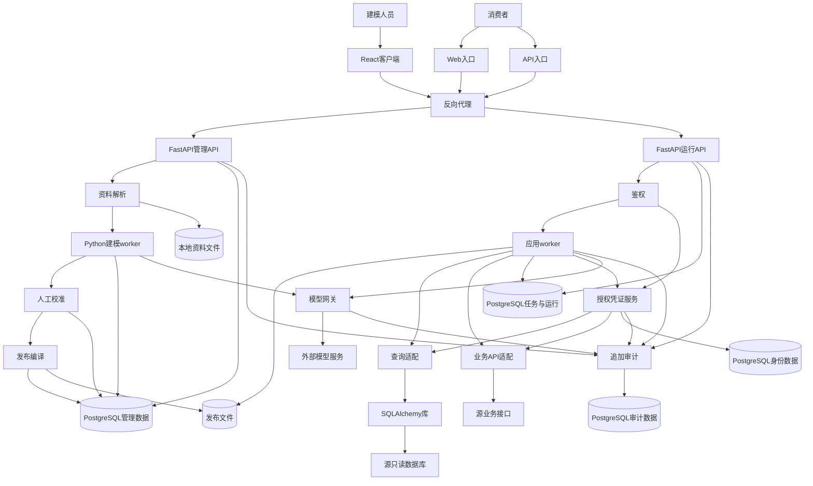

# 设计与交付整理输入夹具

以下是模拟材料，用于 [模型、架构、原型与交互设计、交付整理用例](../行为验证.md#模型架构原型与交互设计交付整理)，不是实际产品需求或执行证据。将“案例目录”替换为隔离目录，只提供当前请求、所需原始材料及固定技能入口；不提供未来轮次或观察标准。模型、架构、原型与交互、交付各组使用独立上下文，多轮结束分别保留产物快照。

## 共用原始材料

产品是跨行业接口接入工具。接入人员修订能力定义并发布；应用只能通过已发布定义调用能力，不得绕过定义服务直连源接口。只有获相应授权的应用可调用，拒绝时不得触发源调用。初始规则是每项调用固定引用一个已发布修订，不自动切换。JSON 和 Markdown 都在产品目标范围，具体实现批次未定。没有存储选型、容量目标和真实业务连接。

教学接口仅用于映射举例，本轮尚未纳入正式集成：`GET /courses/{courseId}/hours`，契约标识 `teaching-sample-1`。输入为字符串课程号，响应的 `teachingHours` 为整数；说明明确单位是分钟。测试数据为课程 `C-17`、响应 90 分钟、教务测试账号，测试账号本身不代表平台权限政策。没有执行过真实业务调用。

## 模型组

第一轮请求：

> 根据共用材料设计本轮概念与逻辑模型，说明规则如何表达。只做第二阶段设计，在案例目录持续维护，不选择技术、不实现应用；未知标明即可。

第二轮请求：

> 参数说明还要能定位到原始材料，这与之前的能力定义维护是同一件事。把“源绑定”统一改称“外部绑定”，含义不变；若初稿采用了其他等义名称，沿用初稿名称也可以。继续更新已有模型。

第三轮请求：

> 现在确定，教学系统进入本轮正式集成范围，采用上述契约作为对接依据；仍需记录它尚无真实连接。请更新相关设计，不实现应用。

第四轮前，由执行者在案例内保存旧模型的真实快照或哈希，并预置一份引用该模型的设计草案：“每项调用固定使用一个已发布修订，调用方不自动切换。”不得预写已实现或验证通过。

第四轮请求：

> 修订选用规则现已改变：同一调用方后续请求跟随最新已发布修订，开始执行的请求在结束前保持其开始时选定的修订。请更新模型及影响说明；预置的旧设计暂不重写，不实现应用。

局部反例请求，使用新的隔离上下文：

> 只整理一个无状态日期解析函数的类型与错误契约。输入为不含时区的 ISO 日期文本 YYYY-MM-DD，输出为日期值；非法日期、空串和非字符串返回不同错误码，不改变旧接口。没有持久化或外部调用。不需要架构或迁移设计。

## 架构组

第一轮请求：

> 根据共用材料设计本轮架构，不选具体库、不实现应用。附有一份已有实验记录：离线脚本将硬编码的教学参数发给替身，返回预置的 90 分钟，单条通过；没有经过定义服务和授权检查。请结合记录说明当前方案、取舍、证据和限制，在案例目录维护。

第二轮请求：

> 增加一份同类脚本记录：10 个固定课程号均返回预置值，其他路径和环境未变。只更新分析，不实现或重新执行。

第三轮请求：

> 新增已确认的外部约束：源系统按调用应用分配独立身份，不能共享一个服务账号；仍不得绕过定义服务。请更新当前候选架构和影响，不实现应用，实际身份凭据和真实执行尚未具备。

局部反例请求，使用新的隔离上下文，只附第一轮实验记录：

> 仅核对这份局部 demo 记录支持什么结论、还缺什么证据，不做架构设计、不实现或运行。

## 原型与交互设计组

I-01 使用共用材料、系统实现方案组的完整系统设计输入，以及以下已确认的交互事实：

> 消费者可以查看一次调用的进行状态和结果。缺少任一必需来源授权时显示待授权；授权完成后可继续原调用。拒绝时显示拒绝结果，不得触发源系统调用。外部动作发出后超时可能已经生效，界面不得把重试描述为必然不重复。消费者没有编辑能力定义、查看其他空间调用或公开分享结果的权限。页面使用现有 Web 应用导航；本轮没有视觉规范，也没有真实用户测试。

I-01 的项目上下文指定：原型设计工具为本地可操作 HTML 原型；正式原型源放在案例目录 `prototype/`，可编辑源与页面预览同址维护，没有外部设计平台。

I-01 请求：

> 根据上述已确认需求和设计，完成消费者“发起能力调用并查看结果”的原型与交互设计。使用项目上下文指定的本地 HTML 原型，实际走查核心流程并形成交互和设计规范。不实现业务应用、不调用真实服务，也不自行确定重试政策。保存原型与分析产物到案例目录，并说明仍缺什么。

I-02 使用现有列表页、已定后端接口和可编辑原型，不要求复用共用材料；项目上下文指定继续在现有原型的文件中维护：

> 这个列表页已经有侧栏、搜索、分页和条目标题操作。删除规则与接口已经确定：仅有权用户可删除，成功后条目消失，失败时保留条目。现在只改善删除确认、执行中、成功和失败恢复的交互，更新现有原型并实际走查，不改信息架构、业务权限或接口。给出可直接交给研发和测试的原型、交互与设计规范，不实现应用。

## 交付组

第一轮请求：

> 根据共用材料细化“应用通过发布能力进行读取”的故事与验收，并给出本地研发测试任务草稿及依赖。只围绕这个结果，不实现或创建远端任务；相关设计尚未完成，不能编造实现。用教学数据示例说明用例，在案例目录持续维护。

第二轮请求：

> 再强调一次，拒绝未授权请求后不能调用源系统。教学样例只测试 C-17，不限制产品只能查询课程；请继续整理已有故事和计划。

第三轮前，由执行者预置一份模拟旧证据，引用第一轮 AC 的实际快照：本地任务标记为关闭；旧规则替身用例只检查了未授权请求收到拒绝响应，结果通过，未观察源调用。该记录是测试夹具，不是真实产品执行。

第三轮请求：

> 现在新增并确定：应用授权撤销后尚未开始源调用的请求也必须拒绝，已经开始的请求允许结束。请更新故事、AC、相关任务与依赖；保留已有执行记录，不重跑测试、不实现应用。

第四轮请求：

> 进展更新：授权拦截研发任务负责人报告实现完成，但尚未提供实现版本或运行记录；测试数据已经准备，测试尚未执行。只更新计划状态，不改变上述规则。

领域反例请求，使用新的隔离上下文：

> 产品就是教学管理系统。教务管理员只能查询自己负责课程的分钟数，非负责课程拒绝且不返回数据。只给这个功能的故事与 AC，课程及教学角色属于正式范围；不做架构、任务或开发。

## 独立阅读

在新的上下文仅提供相应组的当前正文和必要规范引用，排除聊天、历史、样例分析与执行报告。分别请求：

- 说明模型对象、关键概念／关系、规则承载、适用范围与缺口。
- 说明架构为何这样选择、主要责任和链路、成立条件与未知；若为完整系统方案，还请说明系统分层、模块所用技术、基础设施、运行协作和部署如何解决需求，哪些缺口仍阻塞实施。
- 说明本批用户结果、故事边界、验收判据、依赖以及当前状态；只陈述正文给出的证据摘要，不推测实际执行。

共同补充：无法从提供内容判断的地方请指出，不读取其他材料，不替文档补做设计。完整第五阶段的独立交接另只提供一个故事及其必要引用／关联任务，请读者说明本次目标、要完成的任务及产出、验证条件及预期、依赖与阻塞，不提供交付总览或原始请求来补全缺口。

## 系统实现方案组

以下请求分别用于 A-04～08，各例使用独立目录和干净上下文。A-05 复制 A-04 的真实产物作为起点并保存输入快照；A-08 使用下方固定材料。原始输入不包含测试判据。

### 完整系统设计输入

产品是跨行业能力发布与调用平台。接入人员上传 JSON／Markdown 资料，或人工维护能力定义、参数和外部接口映射，校准后发布固定版本。消费者只能调用获授权的已发布能力；不得绕过发布定义直接请求外部接口，空间之间的数据和凭证隔离。

Web 和后端 API 使用同一应用定义及权限规则。应用支持多步骤调用，耗时步骤可异步完成；消费者可以查看状态和结果。执行前须具备所有必需来源授权，拒绝时不触发源调用。进程重启后保留发布版本、运行状态和调用事实；外部业务动作发出后超时可能已经生效，不得一律自动重发。

首期部署到一台内部主机，团队主要使用 TypeScript 前端和 Python 后端，可以维护关系数据库和本地文件卷，未选具体框架及新增基础设施，没有既有应用代码。当前没有并发／容量目标和真实源凭据，不得虚构测量值或业务调用已成功。HTTP 来源接口的真实幂等、身份及权限契约仍需逐来源核实。

A-04 请求：

> 使用上述材料完成第三阶段，给出我们据以实现系统的技术方案。未确定的技术可以按这些约束选型并说明依据，在案例目录保存。只做方案与必要查证，不安装依赖、不实现或部署应用，不发起真实业务请求。

A-05 请求，附 A-04 产物：

> 沿用这份方案中已选的技术。现在确定：用户可以在应用启动时再完成多个来源的授权，缺任一必需授权时显示待授权，授权完成后可继续；进程重启也能找回等待的运行。请更新相关方案，不实现应用或调用真实认证服务。

### 阶段完成评审输入

待评草案正文为：

> 系统分表现层、业务层、数据层。表现层接收请求，业务层完成业务，数据层保存数据。前端框架可选，后端可用 Python 或 TypeScript；存储可以选文件或数据库，任务运行器后续决定，授权模块负责安全。组件之间通过接口协作。运行链路是请求、处理、返回。部署时可采用容器。验证计划包括授权、恢复和吞吐测试，均未执行。阶段三已完成，可交研发实现。

A-06 请求：

> 评审这份草案能否宣布第三阶段完成并据以实现，说明依据与还缺什么。只评审，不修改系统或实现应用。

### 小型完整方案输入

A-07 请求：

> 为本地命令行 JSON 校验工具给出完整技术实现方案。约束已经确定：使用 Python 3 及标准库；单进程读取一个本地 UTF-8 JSON 文件，检查顶层对象的 id 和 name 是否为非空字符串，输出报告到终端；成功退出码为 0，校验或输入错误为非 0。不需要网络、登录、数据库、后台任务或历史记录。本轮不写代码，保存到案例目录。

### 固定图示修改输入

以下是已选方案，不要求重新选型：TypeScript／React 浏览器客户端、Python／FastAPI 管理与运行 API、Python 建模与应用 worker、独立授权凭证服务、模型网关、PostgreSQL 平台状态和本地文件卷，部署在一台内部主机，经反向代理进入。PostgreSQL 用独立角色区分管理、运行、身份和审计数据访问；不引入独立消息中间件，后台任务从持久任务表领取。管理进程没有业务变更凭证，运行侧只能加载已发布版本，来源业务数据保留在源系统。

资料解析、候选生成、人工校准及发布属于定义管理；图中 SQLAlchemy 是查询适配的实现库，不能当作独立服务。Web／API 经过相同鉴权进入运行，应用 worker 通过受控来源适配器访问业务接口／只读数据库，来源凭证由独立服务按用途提供。授权、模型调用和审计是共享支撑，日志不能保存秘密；暂未做系统实现与运行验证。

原图：

A-08 请求：

> 总览图太挤，难以看清系统怎样工作。请改善这份图示和阅读说明，保留已有实现决定，保存到案例目录。不开发或部署系统，不安装依赖。若有现成可用的渲染工具，可以生成预览；没有就如实说明。

## 第五阶段研发交接组

各例用独立案例目录和固定技能副本；只提供本例请求及下列必要材料，不提供行为验证表。远端用隔离模拟器或测试项目，不操作真实任务系统。检查输出深度、维护位置和可执行性，不匹配标题或固定任务数量。

### 共用需求与设计

产品为内部知识条目工具。本轮交付两个用户结果：收藏条目，以及查看自己的收藏。

- 登录主体来自服务端 `CurrentUser`，不可由请求体指定；未登录返回 401，无读写。条目可见性由已有 `CanReadEntry(user, entry)` 决定；不存在和不可见均返回 404，不泄漏条目信息。
- 收藏前检查当前条目可见性；同一用户重复收藏同一条目返回已有收藏，不重复插入。不包含取消收藏、分享、通知或公开收藏榜。
- 查看时仅返回本人收藏且当前仍可见的条目；条目撤权或删除后不显示，不泄漏被滤掉的条目计数。无结果返回空列表。
- 已选实现为 TypeScript HTTP 服务与 PostgreSQL，沿用现有身份中间件、条目表和可见性函数。本轮新表 `Favorite(user_id, entry_id, created_at)`，唯一键为 `(user_id, entry_id)`；迁移不改动既有条目。
- `POST /v1/me/favorites` 输入 `{entry_id:string}`，空值／非字符串 400；新增返回 201，重复返回 200，响应均为 `{entry_id,created_at}`。并发重复通过唯一键去重，冲突后读取已有记录。
- `GET /v1/me/favorites` 无筛选／分页输入，按 created_at 降序、entry_id 升序返回 `{items:[{entry_id,title,created_at}]}`；首期仅面向小规模内部试用，不承诺容量达标。可见性检查在返回前执行。
- 设计引用标识为 `design-favorites-1`，以上为本轮完整相关契约；无前端交付、真实外部连接及付费调用。测试采用隔离数据库和合成用户／条目，未执行任何实现或测试。没有负责人和排期依据。

L-04 请求：

> 根据上述已确定需求和设计完成第五阶段，产物持续保存在案例目录。本地维护任务，没有远端系统。研发和测试下一步将直接使用这些产物开展工作；本轮不实现应用、不运行业务测试。

L-05 请求，另提供模拟器使用说明和初始状态：

> 根据同一材料完成第五阶段。故事和执行任务正式维护在已接入的测试任务系统，本轮已授权创建和更新；系统只支持 `task` 类型和 `relates_to`／`depends_on` 关联，不能改系统配置。请通过提供的模拟器维护，保留已有来源 ID 映射；本地只保留项目配置及必要交付总览，不实现应用或访问真实服务。

模拟器预置项目 `TEST` 和来源为 `US-001`、标题为“收藏条目”的 `TEST-1`，其正文不完整、状态为未启动；提供实际查询／创建／更新／关联／回查操作。不要将模拟 key 描述为真实平台任务。

L-06 请求，独立使用以下两项材料：

> 完成这两个结果的研发交接，保存在案例目录，不实现应用。第一项是按已确定 `/readonly/v1/items` 契约读取数据：平台可信身份和固定接口映射已定义，来源个人授权与真实凭证尚未提供，允许离线替身验证，真实集成必须取得来源授权。第二项是订单撤销：已明确本人未发货订单可撤销、非本人拒绝，但尚未决定已发货订单是否可撤销及后果。分别说明当前能做什么以及阻塞范围。

第一项补充契约：`GET /readonly/v1/items?owner_id={CurrentUser.source_subject}`，owner_id 不接受用户覆盖；成功返回 `{items:[{id:string,name:string}]}`，401／403 拒绝、超时返回来源不可用，均不改用其他身份；HTTP 适配器接收受限租约引用，由可信连接器注入头，输出屏蔽秘密。来源接口已确认为只读，模拟器可检查请求参数及调用次数。

### 阶段完成评审输入

待评草案为：

> US-001 收藏条目，US-002 查看收藏。DEV-001 实现收藏、查询、鉴权、迁移、审计和测试。TEST-001 验证功能。AC-001 登录后收藏正常；AC-002 无结果时澄清或部分成功。需求和设计请看共用文档。阶段五完成，可交研发。

L-07 请求：

> 只评审这份草案是否足以宣布第五阶段完成并交给研发测试，说明具体缺口，不改写需求、不开发应用。

L-08 请求：

> 沿用 L-05 的维护目标与授权完成交付整理。测试工具条件分别为：完全不可用；已成功写入故事但测试任务创建失败。请在各自隔离案例内处理并报告实际结果，不访问真实平台。

L-09 请求：

> 完成共用需求的第五阶段。本地已有 `scenarios/收藏条目.md`，ID 为 US-001，其正文已包含收藏结果的完整规则、可执行任务和明确验收；请沿用有效内容，另一个结果尚未建故事。只维护案例目录，不实现应用。

执行者先将实际生成且核对完整的单故事材料放入 L-09 输入；不提供目标文件名模板或要求新建第二份 US-001。相邻反例另用 B-01／02 的原始请求，不能混入“完成第五阶段”的范围要求。

上述完整交接案例如先返回本期需求边界建议，测试者随后发送以下决定，再继续观察交接产物；L-07 只做评审，不发送此消息：

> 本期需要建立故事的需求仅覆盖材料中已列出的业务结果，其他需求不纳入。故事按可交付和验收需要拆分，沿用已有故事和有效内容，允许逐项连续完成本期范围的研发测试交接，不用逐项再次确认。维护位置和执行限制沿用原请求。

## 本期需求边界与逐项推进组

各例使用独立目录和冻结技能副本；只向被测代理提供当前轮请求及必要材料，不提供行为验证表。L-11、L-13 依赖前例实际生成的范围草案或产物，逐轮发送消息并保留前后快照。

L-10 首轮材料与请求：

> 我们在做内部知识工具，需求和模型、架构已经有初稿。用户需要收藏条目、查看自己的收藏、取消收藏、给收藏分组、分享收藏给同事；共享权限和分享失效后果还没讨论。首期目标是让个人能快速回看有权限的条目，分组可以晚点做。本地维护分析产物，本轮不开发、不运行业务测试，也不建远端任务。现在开始第五阶段。

L-11 第二轮，使用 L-10 实际返回的需求边界草案，并补充“第五阶段研发交接组”的共用需求与设计：

> 本期需要建立故事的需求只覆盖“个人收藏条目”和“回看自己的收藏”；取消收藏、分组和分享暂缓。请在这个需求边界内逐项拆分故事并完成研发测试交接，允许连续推进，无需每项再次确认。行为和实现契约以上面的共用需求与设计为准；本地维护，不实现应用、不运行业务测试。

L-11 恢复轮，使用第二轮实际保存的材料，在新会话发送：

> 读取案例目录的有效决策、交付总览及必要故事，继续尚未完成的第五阶段工作；如果本轮范围已完成，核对状态后说明结果。

L-12 三个独立相邻案例，前两例提供共用需求与设计，第三例复制 L-11 实际保存的产物：

> 只细化“收藏条目”这一个故事和 AC，使用共用需求与设计中的收藏规则；查询列表、取消、分组与分享不在本轮，不做任务拆分或开发。

> 在上述内部知识工具需求中，由你根据“个人快速回看有权限的条目”这个首期目标决定本期需要建立故事的需求边界；多人协作、分组和分享不纳入。采用共用需求与设计中的有效契约，边界明确后逐项完成故事和 AC，不拆任务或开发。

> 沿用已保存的本期需求边界、故事和任务映射，只核对当前交接准备状态，没有新增实现或测试证据，不改需求边界、不补做开发。

L-13 范围变化轮，使用 L-11 实际保存的材料：

> 考虑把“取消收藏”需求也纳入本期，先讨论会怎样影响本期需求边界和后续交付，不修改已有决定，也先别建新故事和任务。

L-13 拆分调整另使用 L-11 产物的独立副本：

> 本期需求边界保持不变，只重新评估已纳入需求的故事拆分，使各项便于独立交付和验收；可以调整故事数量、边界及顺序，保留稳定 ID 的承接关系，不增加任何新需求，不实现应用。

L-13 局部阻塞另用独立案例：

> 本期需要建立故事的需求已决定只覆盖“撤销自己的订单”和“收藏知识条目”，均只完成故事和 AC，优先处理订单需求。撤销订单时，已明确未发货可撤销、非本人拒绝，已发货能否撤销及后果仍待业务决定；收藏规则沿用共用需求与设计。允许连续推进，不实现应用。
